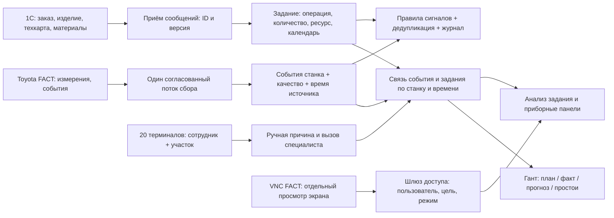

# DPA и развитие MES: задания, Гант, сигналы, простои и доступ

Проверка: 15 сентября 2026, примерно 16:37–16:44, Asia/Tashkent. Объект: авторизованный веб-интерфейс `dpa.parisahome.com:30200`, документация Host API v7.1, доступный просмотр пользовательского скрипта. Сопоставление с клоном MES `FACT_gpt` и предыдущим [архитектурным аудитом](MES_ARCHITECTURE_REVIEW.md).

**Граница проверки:** это аудит наблюдаемого поведения и логической архитектуры интеграции. Исходный код ядра DPA, её БД, инфраструктура и журналы сервера недоступны. Производственные задания, причины, настройки, права, триггеры и программы станков не изменялись. Выполнялись навигация, фильтрация и просмотр. Нагрузочные тесты DPA не проводились. Результат предыдущего теста Python/SQLite 80/20 нельзя переносить на DPA.

## Вывод

В DPA уже есть большая часть требуемых функций: задания и зависимости, план/факт Ганта, история станка, классификация причин, панели, сценарии сигналов, VNC и права. **Следующий этап — связать их в понятный производственный процесс и обеспечить достоверность данных.** При расширении собственной MES эти функции стоит использовать через проверенные контракты, сохраняя одного владельца заданий и ручных причин.

Обнаружены два конкретных сбоя: неработающий классификатор простоев и ошибка анализа выбранного задания. Они важнее визуального расширения панелей.

## 1. Что проверено и что требует действия

| Приоритет | Наблюдение | Значение и следующий шаг |
|---|---|---|
| Высокий | В «Сигналы 2.0» триггер «Классификация простоев по кодам ошибок» имеет «Работает: нет», «Ошибка запуска», `expired timeout in 5000 milliseconds, stopped`; время статуса 15:52:10 | Разобрать запуск и журнал, воспроизвести на тестовой копии. Не увеличивать тайм-аут вслепую. Возможное влияние на нераспознанные причины пока не доказано |
| Высокий | «Анализ задания»: выбор задания `1700, 7050 J326 500, 4608` (ID 75115957) дал `Object reference not set to an instance of an object.` | Задание было «Создано», без показанных назначения и времён. Проверить обработку неполной карточки и связей. Вместо исключения нужен список недостающих данных. Один пример не означает сбой всех заданий |
| Высокий | На стартовой странице: 45 драйверов, из них 4 сбойных | Проверить какие источники затронуты и их последние ошибки. Драйверы включают другое оборудование предприятия, поэтому 45 нельзя считать количеством ткацких станков |
| Высокий | Панель DOBBY показывает отрицательные остатки с единицей `m`, обороты при состоянии «Простой»/«Аварийный стоп», несколько полей скорости в каталоге | Проверить масштаб, единицу, тип скорости, время измерения и качество. Значение при остановке может быть уставкой/последним измерением; ошибку оборудования этим не доказываем |
| Средний | Гант D-01 на 15.09 с включёнными «План», «Факт», «Тикеты» показал тикет механика, без полос заданий | Тикет присутствует независимо от задания. Проверить назначение задания станку и регистрацию запуска. Пустой план одного станка/дня не доказывает отсутствие всей истории |
| Средний | Глобальная панель Jobs открылась на неделе 13–19 июля, выбран только план | Сохранённый период мешает ежедневной работе. Добавить режим «Текущая неделя», кнопку «Сегодня» и заметную подпись периода; исторические закладки оставить явными |
| Средний | В DOBBY на момент просмотра «Не определено» составляло 47,5% текущей смены и 31,2% прошлого производственного дня | Установить, откуда берутся интервалы: связь, расписание, классификатор состояния или историческая загрузка. Не объединять неизвестное состояние с известным остановом без человеческой причины |
| Средний | DowntimeReason показала 40 станков и легенду из Undefined, Short stop, STOP SWITCH PRESSED | Проверить покрытие классификации по длительности и числу событий. Обрывы могут относиться к другой категории/фильтру; легенда не доказывает, что их нет |
| Средний | У одного работающего станка в Tiket отображается несколько вызовов специалистов, в том числе повторная подпись | Разделить открытые вызовы и историю; показать статус каждого. По одной подписи нельзя считать записи дубликатами |
| Средний | Классификацию простоев разрешает общая группа «Пользователи», кроме мастеров/технологов/администраторов | Уточнить назначение группы и ограничения по оборудованию. Проверить отдельной ограниченной учётной записью. Наличие широкого разрешения в UI не доказывает обход серверной защиты |
| Требует проверки | VNC для D-01 при выключенном «Управление» открыл пустую область `about:blank`, в том числе в отдельной свежей вкладке | Подключение к экрану не подтверждено. Проверить назначение VNC-узла, доступ, прокси и журнал. Это не проверка VNC самого сервера FACT |

В ходе переходов после ошибки анализа оставался индикатор загрузки. После перезагрузки страницы он исчез. Поэтому первоначальное ожидание VNC проверено повторно в отдельной вкладке; причиной пустого экрана по браузеру назвать конкретный сетевой компонент нельзя.

Прямые входы для владельца системы: [сигналы 2.0](http://dpa.parisahome.com:30200/#signals2/triggers), [анализ задания](http://dpa.parisahome.com:30200/#/analytics/singleJobAnalytic), [Гант заданий](http://dpa.parisahome.com:30200/#/analytics/jobsGantt), [права доступа](http://dpa.parisahome.com:30200/#/security/permissions). Требуется авторизация.

## 2. Логическая архитектура и владение данными

Это предлагаемое разделение ответственности, не обнаруженная схема развёртывания DPA.

### Рекомендация для сосуществования DPA и Python MES

- Пока DPA используется для оперативного учёта, задания/назначения и причины, вводимые через неё, должны иметь DPA ID в собственной MES. Собственная MES может хранить локальное представление для отчётов и специфические поля полотенечного цеха.
- Если операторский ввод переносится в новый UI, запись должна идти через адаптер к выбранному владельцу события. Нельзя независимо создать «ручной останов» в двух системах и затем суммировать оба.
- 1С остаётся владельцем заказа и справочной части техкарты; ручные PPT/панели/назначения имеют отдельные правила обновления и периоды действия. Импорт должен быть повторяемым и учитывать версии.
- При переходе к собственному учёту определить дату переключения владельца и таблицу соответствий. Параллельное чтение удобно для сверки; двусторонняя бесконтрольная запись — источник конфликтов.
- Dobby, Bonas и Staubli — группы/возможности оборудования и варианты отображения. В данных нужна единая сущность станка с адаптером источника и картой поддерживаемых полей. Отдельные независимые модели остановов для каждой группы не нужны.
- 20 терминалов получают агрегированные данные из MES. Ни опрос Toyota, ни тяжёлый пересчёт, ни VNC-сессия не должны запускаться автоматически по одному экземпляру на каждый экран.

### Доступные точки интеграции

Встроенная документация **Host v7.1 / OpenAPI 3.0** содержит следующие контракты. Прочитана документация; прямые вызовы этих методов, проверка их прав и схем ответов не выполнялись.

| Задача | Наблюдаемые методы |
|---|---|
| Текущие остановки и индикаторы | `POST /api/Dashboard/getCurrentDowntimesByWorkCenter`, `getWorkCenterIndicatorsByNames`, `getIndicatorData` |
| Доступные причины | `GET /api/DowntimeReason/getDowntimeReasonsForEquipment/{equipmentId}` |
| Карточка останова | `GET /api/DowntimeReason/getFullDowntimeInfo/{recordId}` |
| Изменение причины | `POST /api/DowntimeReason/updateDowntimeInfo/{recordId}` — будущая запись только через согласованный адаптер |
| Гант состояний / заданий | `POST /api/Gantt/getEquipmentSummary/{equipmentId}`, `getJobs/{equipmentId}`, `getJobDetail/{jobId}`, `getJobOutput/{jobId}` |
| Пакетная история | `POST /api/Gantt/getExtendedWorkCenterSummary` — проверить состав и пределы пакетного запроса |
| Карточка задания / расчёт плана | `GET /api/Jobs/{jobId}/jobCard`, `POST /api/Jobs/getPlanningTimeInfo` |
| Жизненный цикл задания | `POST /api/Jobs/start/{jobId}`, `suspend/{jobId}/{suspendReasonId}`, `resume/{jobId}`, `adjust/{jobId}` |
| Причины потерь | `POST /api/Analytics/downtimeClassification/complex`, `dynamicsOfDowntimeReasons` |
| VNC | `GET /api/vnc/connection/{equipmentId}/{isControl}`, отдельные методы назначения пользователей и разрешения управления |

Документация: [Описание API DPA](http://dpa.parisahome.com:30200/#/apiSpecifications/host). Для адаптера нужен разрешённый список конкретных методов: в этой API даже некоторые GET описаны как изменяющие действия (например, очистка). Один только HTTP-метод не гарантирует чтение.

Контракт адаптера должен проверять: идентификаторы станка/заказа, пагинацию, часовой пояс, `[start,end)` интервалы, точность времени, единицы, пропуски, версии, пределы периода, доступ пользователя. При недоступности DPA отдавать последний снимок с возрастом и явным запретом неподтверждённой записи, а не подставлять нули.

## 3. Какие диаграммы Ганта нужны

### А. Планирование и диспетчеризация

Строка — станок, группировка Dobby / Bonas / Staubli. По времени показать отдельно:

1. Утверждённый план: наладка, производство, техническое обслуживание.
2. Фактическое выполнение задания, разделённое на запуски и паузы.
3. Прогноз окончания оставшегося количества, пунктиром.
4. Остановы и ручные причины, связанные с конкретными событиями.
5. Дедлайн заказа и доступный производственный календарь.

Режимы: смена, сутки, неделя; фильтры по участку, станку, заказу, риску опоздания. На 80 станках нужны видимые строки по выбранной группе и подгрузка деталей по запросу. Масштабирование картинки само по себе эту задачу не решает.

План не передвигается вслед за прогнозом автоматически. Перенос диспетчером сначала показывает последствия: соседние задания, материалы, совместимость оборудования, переналадка, конечный срок. Сохранение плана — отдельное действие с проверкой версии. Завершённый факт через drag-and-drop не редактируется.

### Б. История конкретного станка

На общей временной оси: машинные состояния, сообщения/коды ошибок, программа/дизайн, выпуск, выбранные индикаторы, человеческие причины и вызовы специалистов. Из карточки задания переход сюда должен сохранять станок и период. Неизвестный интервал показывается разрывом/штриховкой, а не производством или простоем.

### Минимальная модель задания

`job_id`, `order_id`, `product_id`, `operation_id`, `technology_version`, количество и единица, список подходящих станков, назначенный станок, плановые интервалы, срок, календарь/его версия, фактические периоды, годный выпуск и брак при наличии, причина приостановки, ревизия и источник.

Производственный заказ может делиться на несколько заданий разных станков; наладка и производство могут иметь зависимости и отдельную длительность. Отменённое/завершённое задание сохраняет историю. Незаполненное назначение — очередь «Не назначено», а не скрытая пустая строка Ганта.

### Расчёт прогноза

Для нормы из Toyota: `полотенец/час = 60 × RPM / PPT × панели × ожидаемая эффективность`. Остаток делится на этот темп и размещается в доступных интервалах календаря с учётом ожидаемой наладки. Нужны подтверждённые PPT и панели именно действующего изделия.

Для нормы из 1С: если секунды на ряд уже учитывают 75% эффективности, этот коэффициент повторно не применяется. При прогнозе по измеренному фактическому темпу не нужно ещё раз уменьшать его на ту же эффективность.

При отсутствии материала, нормы или свежего выпуска показывать «Прогноз недоступен» и причину. Допустимо дать диапазон оценки, но не точное выдуманное время.

**Интерактивная демонстрация:** [docs/mes-gantt.html](docs/mes-gantt.html). Вымышленные задания шести станков, фильтры групп/риска, отдельные план/факт/прогноз, причины остановок и сценарии дополнительного простоя/изменения эффективности. Это макет для согласования, не подключённый к DPA планировщик.

Проверка макета: в браузере подтверждены переход в причину, фильтры участков/риска, пустой результат, скрытый прогноз при старых данных; +60 минут останова меняют прогноз D-01 с 19:30 на 20:30. На ширине 1024 px страница укладывается в экран; на 390 px шкала прокручивается внутри контейнера, страница не выходит за экран. Ошибок JavaScript не обнаружено. Производственные UI/API не менялись; сквозные тесты рабочей MES для этого документационного макета не запускались.

## 4. Сигналы: что именно можно использовать

Следует различать **индикатор** (измерение/состояние Toyota), **событие** (например, начался останов), **правило сигнала** (условие и выдержка) и **действие** (показать мастеру или сформировать задачу). В DPA слова «Сигналы» и «Сигналы 2.0» относятся к правилам/скриптам, а не только к датчикам.

### Каталог D-01

Просмотрены все 11 страниц: 106 настроенных индикаторов Channel 0. Наличие в каталоге не доказывает, что каждое поле измеряется и историзируется. Названия — текущие подписи DPA, а не расшифровка протокола Toyota.

| Группа индикаторов | Применение | Проверка перед использованием |
|---|---|---|
| Останов, ручной режим, основа, уток, кромка, леновер, поломка, питание | Автоматическая классификация, очередь ручного уточнения | Переходы, приоритет одновременных причин, код источника |
| Несколько скоростей: «факт», «обороты в минуту», «информационная» | Отклонение скорости от нормы изделия, прогноз | Разделить уставку, факт и последнее значение; добавить время измерения |
| Эффективность смены/24 часов, время работы и остановки | Сменная сводка и сравнение с собственным расчётом | Период, знаменатель, связь с доступностью. Полная OEE требует отдельно подтверждённого качества |
| Выпуск в прокидках/метрах/штуках, отдельные счётчики смен 1/2/3 | Факт задания и 1С | Сбросы, приращения и начало смены; «ряд» и «полотенце» различаются |
| Остатки, верхний навой, прогноз подготовки/смены | Предупреждение навойщику, подготовка материала и переналадки | Масштаб, отрицательные значения, применимость верхнего навоя |
| Дизайн, стиль, ткань, бобина, параметры структуры | Проверка соответствия задания и программы, прослеживаемость рулона | Стабильная связь с изделием и версией; разные имена файлов/артикулов не всегда ошибка |
| «Поток воздуха системы вентиляции» | Кандидат на диагностику расхода сжатого воздуха | Подпись выглядит неоднозначно для ткацкого оборудования; сопоставить с исходным `Flow`, не трактовать как вентиляцию без проверки |
| Натяжение нити и отдельный индикатор «Единицы измерения натяжения» | Корреляция с обрывами основы, нормы для изделия | Прочитать значение единицы и сравнить с панелью. Само наличие этого индикатора ещё не подтверждает единицу |
| `WarpStopG`, `WarpStopP`, обрывы основы/утка за смену/день | Число обрывов, частота на объём выработки | Флаг или счётчик, G/P и физическая система; нули на карточке не доказывают отсутствие обрывов |
| Предупреждения, блокировки, техническое обслуживание | Подсказка инженеру, история неисправностей | Назначение кодов и применимость; MES не должен автоматически вмешиваться в блокировки |

Для давления, расхода и натяжения дополнительно есть локальные файлы FACT, разобранные в [каталоге Toyota](TOYOTA_SIGNALS.md). Источники DPA и зеркало нужно связать таблицей соответствий: станок → драйвер → поле → единица → период обновления → история → качество.

### Правила, которые принесут пользу

Ниже стартовые варианты для пилота, а не утверждённые технологические нормативы. Числа выдержки подбираются по истории и согласуются с цехом.

| Условие | Кому / для чего | Защита от ложного сигнала |
|---|---|---|
| Ручной останов без человеческой причины дольше 2 минут | Оператор: указать причину; затем мастер | Только свежее активное событие, один запрос на `event_id` |
| Длительный останов / специалист не принял вызов | Мастер и соответствующая служба | Отдельно время до принятия и ремонта; подтверждение не закрывает физический останов |
| Работающий станок без назначенного задания | Диспетчер: связать факт с заказом | Не объявлять отсутствие задания браком; учитывать переход на новый заказ |
| Дизайн отличается от утверждённой версии задания | Технолог: проверить перед продолжением партии | Таблица соответствий и разрешённых версий; изменение имени не равно изменению рисунка |
| Навой/съём ожидается в ближайшие 30 минут | Подготовить людей и материал | Действующий прогноз, известные единицы, подтверждение актуальности |
| Темп выпуска устойчиво ниже нормы изделия | Мастер: проверить скорость/частые остановы | Сравнимые изделия, окно наблюдения, исключение наладки и неизвестных данных |
| Прогноз окончания позже срока | Диспетчер: пересмотреть очередь | Раздельные план и прогноз; проверенный календарь и остаток |
| Обрывы на 100 тыс. прокидок выше своей нормы | Технолог: проверить материал/натяжение | Минимальный объём наблюдения; сравнение одинаковой технологии |
| Расход воздуха изменился при одинаковом режиме | Инженер: диагностика утечки/настройки | Подтверждённая единица; сравнение по изделию и оборотам, без автоматической записи уставок |
| Toyota устарела / классификатор перестал работать | Поддержка: восстановить данные | Один общий инцидент источника, подавление вторичных тревог по всем станкам |
| Сообщение 1С не применено или пришла старая версия | Ответственный за интеграцию | ID сообщения, причина отказа, повтор без дубликата |

В существующем правиле «нет дизайна на станке» наблюдались: 3 выбранных рабочих центра, активность включена, группировка 7 минут, журналирование выключено. Условие триггера: `TJ_Final2_MedP / je_can_fname = <empty>`, таймаут 0. Это проверка пустого поля, она не проверяет соответствие дизайна заданию и не отличает пустоту от устаревших данных. Группировка сообщений не заменяет выдержку условия. Обработчики не запускались, рассылки не отправлялись.

Для всех правил нужны: версия, владелец, перечень станков, условие качества данных, выдержка, гистерезис/условие восстановления, ключ дедупликации, подтверждение, эскалация и журнал результата действия. Отчёты по расписанию отделить от оперативных тревог; не отправлять уведомление при каждом обновлении значения.

## 5. Классификация причин: три независимые сущности

1. **Физический останов:** станок, начало/конец, автоматический код Toyota, качество времени.
2. **Причина потери времени:** например, замена навоя, наладка, отсутствие материала; человек, версия и история уточнения.
3. **Вызов специалиста:** кому, когда создан, принят, начата работа, завершён. Может пересекать несколько физических остановов или продолжаться после запуска.

У DPA это уже частично отражено отдельными тикетами и остановами. Собственной MES следует сохранить такое разделение. Вызов механика на работающем станке не обязательно ошибочен; нужно показывать его статус и связь с событием.

Справочник причины должен иметь стабильный код, RU/UZ-названия, категорию, допустимые станки/операции, необходимость комментария, плановость и правила влияния на показатели. «Не определено» и «Короткий останов» описывают качество классификации/длительность; ими нельзя подменять физическую причину обрыва.

В просмотренном скрипте классификации комментарии описывают уникальные коды справочника, классификацию только ещё не классифицированных остановов и выбор первого кода при нескольких ошибках. Это полезный исходный контракт, но нельзя считать полный код проверенным: просмотрены фрагменты. На тестовой копии проверить область драйверов, уникальность кодов с учётом модели, регистрацию событий, запросы на старте, ограничение пачек, индексы и возобновление с точки обработки. Повторная обработка не должна затирать ручное уточнение.

Для Парето показывать длительность и количество отдельно, долю классифицированных остановов, неизвестное состояние отдельно. Распределение причин по заданию считать по пересечению интервалов; одна минута одного станка не суммируется несколько раз из-за нескольких тикетов. Полезны также MTTR физического ремонта и ожидание специалиста как разные показатели с согласованными определениями.

## 6. Приборные панели и роли экранов

| Панель | Что оставить на первом экране | Что вынести в подробности |
|---|---|---|
| Dobby / Bonas / Staubli | Станок, состояние и его возраст, задание/изделие, факт/план, нужное действие, ближайшая замена | Сырые поля, все три сменных счётчика, расширенные параметры |
| Jobs | Сегодня/текущая неделя, очередь неназначенных заданий, Гант план/факт/прогноз, риски | Редактирование технологии, история пересчётов |
| DowntimeReason | Требуют причины, Парето минут и числа событий, доля классификации | Полный журнал, фильтры кодов и история изменений |
| Мастер | Все 80 по участкам, первые требующие внимания, ответственность, прогноз окончания | Детали конкретного станка по нажатию |
| Терминал оператора | Свой участок, текущий сотрудник, причина в два нажатия, результат записи | Отчёты и служебные настройки не нужны в основном потоке |

Сейчас каталог содержит личные, глобальные, тестовые и старые варианты панелей; в просмотре отображалось 36 строк. Подробно просмотрены личная DOBBY и глобальные Bonas, Jobs, DowntimeReason; одноимённая глобальная DOBBY может иметь другие настройки. Для цеха нужны закреплённые утверждённые панели, понятные названия и единый словарь. Просмотренные DOBBY-карточки перегружены и имеют вложенную прокрутку. Базовый [макет терминала](docs/operator-terminal.html) подходит как направление; требуется реальная интеграция с событием и правами.

## 7. VNC FACT

**Подключение возможно как отдельная функция просмотра**, если сервер FACT предоставляет совместимый VNC и разрешён сетевой маршрут. Наличие VNC у FACT сообщено пользователем; фактические адрес/порт, режим и совместимость не проверены. Проверялся только существующий экран VNC DPA для D-01 — картинка не появилась.

DPA уже документирует подключения VNC с флагом управления и отдельные права пользователей по оборудованию. Предпочтительно сначала проверить этот механизм, чтобы не создавать второй контур доступа.

Если требуется собственное встраивание, noVNC работает в браузере через WebSocket/RFB; для обычного TCP VNC используется соответствующий прокси. Есть режим `viewOnly`, но это клиентская настройка, она не заменяет серверное ограничение прав. [Документация noVNC](https://novnc.com/noVNC/docs/API.html), [развёртывание](https://novnc.com/noVNC/docs/EMBEDDING.html).

Предлагаемый контур: пользователь MES → проверка права просмотра конкретного узла → короткая сессия шлюза → VNC FACT. Пароль остаётся на сервере, адрес назначения выбирается из разрешённого списка. Запись клавиатуры, мыши, буфера обмена и команды питания запрещены на серверной стороне для режима просмотра. Доступ защищается HTTPS/WSS и разрешённым сетевым маршрутом; текущая сессия DPA была открыта по HTTP.

VNC нужен инженеру для сверки панелей и диагностики. Он не заменяет сбор структурированных сигналов, не является доказательством свежести телеметрии и не должен постоянно открываться на 20 терминалах. Начальный лимит — один просмотр по требованию с измерением нагрузки на FACT. Экран FACT может показывать несколько станков сразу: разрешение на VNC-узел не равно ограничению видимости одной машины.

Правило проекта «FACT только читать» сохраняется. Удалённое управление в этой архитектуре не включается. В этом аудите VNC не настраивался и доступ никому не выдавался.

## 8. Права доступа

В DPA найдены группы: Администраторы, Пользователи, Операторы, Менеджеры УП, Технологи, Мастера. Есть отдельные разрешения на классификацию, корректировку заданий, редактирование панелей, VNC-настройки и запись в ЧПУ. Некоторые назначения сделаны напрямую пользователям, что усложняет сопровождение. Персональные списки в отчёт не копируются.

Предлагаемая матрица для собственной MES:

| Действие | Оператор | Мастер | Диспетчер | Технолог | Инженер | Администратор |
|---|---|---|---|---|---|---|
| Смотреть состояние | Свой участок | Свой цех | Разрешённые участки | Разрешённые участки | Разрешённые участки | По служебной необходимости |
| Указать текущую причину | Свои станки | Свой цех | Нет | По отдельному праву | Только своя работа | Не выдавать автоматически |
| Исправить прошлую причину | Нет | С обоснованием и журналом | Нет | По отдельному праву | Нет | Не выдавать автоматически |
| Запустить/приостановить назначенное задание | По регламенту участка | Свой цех | По регламенту | Нет | Нет | Не выдавать автоматически |
| Изменить план и назначение | Нет | По регламенту | Да | Нет | Нет | Не выдавать автоматически |
| Изменить технологические нормы | Нет | Нет | Нет | Да, с версией | Нет | Не выдавать автоматически |
| Принять/завершить ремонтный вызов | Нет | Назначение | Нет | Нет | Своя служба | Не выдавать автоматически |
| VNC просмотр | Обычно нет | По отдельному праву | Нет | По отдельному праву | Разрешённые узлы | Разрешённые узлы |
| VNC управление FACT | Нет | Нет | Нет | Нет | Нет | Нет в текущем проекте |
| Изменить роли/интеграции/правила | Нет | Нет | Нет | Предложить правило | Предложить правило | Да, с аудитом |

Роль + участок + вид действия + состояние события проверяются в API. Терминал идентифицируется отдельно от сотрудника; смена сотрудника не меняет устройство. Отдельная сервисная учётная запись 1С имеет только права обмена; сборщик — только необходимые права получения данных. Истечение/отзыв сессии должны прекращать SSE/VNC и запись согласно политике, а не только прятать кнопки.

Проверка прав пока ограничена просмотром конфигурации. Для подтверждения нужны отдельные тестовые аккаунты и сценарии: чужой станок, устаревшая версия события, архивный период, отозванная сессия, прямой API-запрос и VNC вне разрешённого списка. Такие проверки выполнять на стенде, не создавая реальные остановы.

## 9. Порядок реализации

1. Восстановить классификатор по результатам диагностики на копии; исправить обработку неполного задания; сверить свежесть, единицы и календарь.
2. Назначить владельца заданий и причин. Зафиксировать ID/версии и контракт интеграции DPA–MES–1С.
3. Реализовать Гант только для чтения и анализ задания: план, факт, прогноз, причины, качество данных. Сверить один станок и одну смену вручную.
4. Подключить терминал оператора с правами участка, защищённой записью причины и журналом. Пилот на одном участке.
5. Добавить разрешённое диспетчерское редактирование, конфликты плана и зависимости. Сохранять исходный план при пересчёте прогноза.
6. Подключить подтверждённые диагностические сигналы и VNC-просмотр; затем проверка 80 станков / 20 терминалов и суточной работы.

Критерий готовности: одно событие имеет одинаковые границы и причину на терминале, в Ганте, в анализе задания и отчёте; суммы времени не дублируются; прогноз воспроизводим; недостоверные интервалы видны; ограниченный пользователь не меняет чужие данные. Красивый экран без этих проверок недостаточен.
