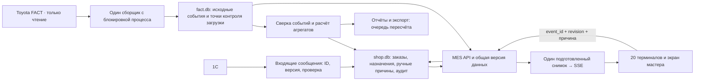

# MES: архитектура для 80 станков и 20 терминалов

Дата проверки: 15 сентября 2026. Код проверен в отдельном клоне `FACT_gpt`. Рабочий сервер, исходный шаблон XLSB и оборудование не изменялись. Анализ Toyota выполнен по локальному зеркалу; запросов к FACT не было.

## Решение

**Python + SQLite + SSE можно сохранить для следующего этапа.** На этой машине испытание с 80 станками и 20 подключёнными терминалами прошло без HTTP-ошибок. Оснований менять стек только из-за количества станков не найдено. Перед расширением необходимо исправить учёт событий остановки, свежесть данных и расчёт итогов Excel. Эти ошибки могут давать неверную производственную картину даже при быстром сервере.

Проверка включает чтение кода, локального зеркала, браузерный просмотр, сквозные тесты, короткую нагрузку и отдельное воспроизведение гонки создания остановок. Это не подтверждение круглосуточной готовности. Оставшиеся проблемы ниже пока не исправлены.

Связанные материалы:

- [Каталог сигналов Toyota](TOYOTA_SIGNALS.md).
- [Разбор интерфейса и сценариев](UI_REVIEW.md).
- [Интерактивный макет терминала](docs/operator-terminal.html), полностью вымышленные данные.
- [Предыдущий аудит и уже исправленные ошибки](AUDIT_REPORT.md).

## Как должна проходить информация

Это целевая схема, часть её ещё предстоит реализовать. Исходные машинные события принадлежат Toyota; человеческая причина, исполнитель и история исправлений — MES; техкарта изделия заказа и справочники — 1С. Один набор данных не должен молча подменять другой.

В текущем коде уже есть полезное разделение модулей, SQLite WAL, дневные агрегаты остановов и переиспользование подготовленного SSE-снимка. Ключ техкарты «заказ + номенклатура» соответствует предметной области. Клиенты получают данные через MES, поэтому 20 мониторов не должны создавать 20 опросов Toyota.

## Что измерено

Испытательная машина: Intel Core Ultra 9 185H, 16 ядер / 22 логических процессора, Python 3.12.10. Это локальная машина проверки; скорость рабочего сервера не измерялась.

Для каждого прогона: 30 секунд, 20 SSE-подключений, 20 отправителей ручных причин с интервалом 2 секунды, 4 читателя отчётов, импорт фикстуры 1С и пересчёт дневных агрегатов каждые 10 секунд. Сценарий реализован в `_tools/mes_benchmark.py`, ограничен временной песочницей с маркером и `127.0.0.1:8790`.

Вариант 80 получен расширением копии данных 40 станков. Это синтетический объём: 3 027 092 записи `stop_log`, 138 дней с данными, база около 550 МиБ. Все 80 станков в тестовом снимке остановлены вручную, чтобы запросы записи действительно выполнялись.

| Операция | 40 станков: p95 | 80 станков: p95 | Максимум на 80 |
|---|---:|---:|---:|
| Запись причины, 300 запросов | 90 мс | 145 мс | 302 мс |
| Чтение отчётов и экранов | 193 мс | 477 мс | 3 181 мс |
| Импорт 1С, всего 3 запроса | 485 мс | 1 212 мс | 1 212 мс |
| Пересчёт дня, всего 3 запуска | 43 мс | 67 мс | 67 мс |
| Доставка изменения снимка на 20 экранов | 275 мс | 284 мс | 287 мс |

p95 означает, что 95% измерений были быстрее указанного времени. На 40 выполнено 450 чтений, на 80 — 347: тяжёлые запросы заметно замедлились. Три измерения импорта и пересчёта дают только ориентир, а не устойчивую статистику. HTTP-ошибок и пропущенных тестовых SSE-обновлений не было: по 60 доставок на прогон.

Ограничения:

- Доставка измерена от изменения тестового снимка, а не от физической остановки станка.
- Использована одна тестовая сессия администратора; различение 20 сотрудников и их прав нагрузкой не проверялось.
- Успех HTTP не доказывает отсутствие дубликатов, долговечность записи при отключении питания или правильность всех производственных сумм.
- Не проверены сутки работы, год истории, реальная сеть, 20 физических устройств и аварии оборудования.
- Сквозной тест на копии с 80 станками: **91 проверка, 0 ошибок, 17 секунд**. Он не выявляет перечисленные ниже семантические ошибки Excel и конкуренции.

## Приоритеты перед расширением

### 1. Один физический останов — одно событие, ручная причина с историей

**Воспроизведено на отдельной тестовой БД:** два пересекающихся вызова `tickets.open_ticket()` создали два открытых тикета одного станка. Оба успели прочитать отсутствие открытой записи; искусственные времена отличались на секунду. Уникальность `(loom, started_at)` пропустила обе записи. Это доказательство допустимого чередования запросов, не утверждение об инциденте в цеху.

В `_app/tickets.py` проверка и вставка не защищены общей транзакцией. `classify()` не проверяет версию события: другой оператор может перезаписать причину. Нет полноценной истории изменения причины с терминалом и предыдущим значением.

Предлагается:

- Стабильный `event_id`, привязанный к машинному событию, и ограничение БД на единственное активное событие станка.
- Короткая транзакция `BEGIN IMMEDIATE` для проверки и вставки; обработка конфликта с возвратом существующего события.
- Изменение причины по `event_id` и `revision`; конфликт версии — HTTP 409 с актуальным состоянием.
- Журнал: кто, с какого терминала, когда, что изменил, прежняя и новая причина. Повтор одного запроса с тем же ID не создаёт новое действие.
- Перед ограничением уникальности — отчёт о существующих дубликатах и согласованное объединение с сохранением истории.

`poll_once()` восстанавливает начало из `now - state_sec`, а завершение — по следующему снимку. Если между двумя опросами станок успел запуститься и снова остановиться, события могут слиться. История `stop_history` должна уточнять границы; оперативный снимок даёт предварительное состояние. Сброс таймера останова — сигнал возможного нового события, который нельзя игнорировать.

### 2. Разделить связь с MES и свежесть Toyota

**Установлено по коду:** SSE может продолжать посылать ping при остановившемся сборщике. Доска остаётся «онлайн», таймеры растут; устаревание вычисляется при построении нового снимка, который без новой версии может не появиться. Время локального чтения старого файла также не равно времени измерения станка.

Нужны отдельные `source_ts`, `received_at`, время детального измерения и возраст данных на клиенте. Статус свежести должен обновляться независимо от изменения производственных значений. После порога устаревания показывать последний известный снимок и блокировать новую привязку причины к неподтверждённому текущему событию. Пороги выбирать с учётом частоты конкретного источника: оперативное состояние и детальные показатели обновляются по-разному.

Отдельно показывать здоровье Toyota, сборщика, MES и обмена 1С. Остановка 1С не должна скрывать исправную оперативную доску.

### 3. Исправить итог Excel для 80 станков

**Проверено в созданном песочницей XLSX:** строка 85 содержит станок №80, но `J1` остаётся `SUM(G6:G45)`. Формула `J3=(J2/J1)*100` использует неполный знаменатель. В `_tools/fill_template.ps1` часть диапазонов также ограничена строкой 45, хотя последняя строка данных вычисляется динамически. Отсутствующий PPT может дополнительно привести к делению на ноль.

Исправлять нужно диапазоны и формулы создаваемой копии отчёта. Оригинальный XLSB сохраняется неизменным. Проверка: 10/40/80 станков, пустой PPT, итог Excel равен независимо рассчитанному итогу API. Текущая проверка структуры ZIP этого не гарантирует.

### 4. Гарантировать единственного сборщика

**Риск по коду `_app/collector.py`:** запуск из приложения игнорирует результат `claim()`. Проверка JSON heartbeat и его запись не являются атомарной блокировкой. Heartbeat старше 30 секунд может быть принят за смерть процесса, пока идёт медленный полный опрос.

Нужна межпроцессная блокировка, удерживаемая весь срок работы, обязательная проверка результата захвата и отдельный показатель прогресса цикла. Тест: два одновременных запуска, медленный FACT, аварийный выход владельца. Нельзя использовать только возраст heartbeat как разрешение запустить второго писателя.

### 5. Сделать приём 1С атомарным и устойчивым к повторам

`_app/integration.py` фиксирует изменения техкарт раньше завершения последующих этапов назначения, пряжи, плана и отчёта. Поздняя ошибка может оставить частично применённое сообщение. Повторный импорт в обычном сценарии уже обрабатывается, но порядок версий и частичные отказы требуют отдельного контракта.

Входящий конверт должен иметь ID сообщения и версию документа. Сначала полная проверка, затем одна транзакция бизнес-изменений и запись результата обработки. Производные отчёты пересчитывать отдельно с возможностью повтора. Старое сообщение не должно затирать новую версию; ручные PPT, панели и другие поля MES должны иметь явно заданного владельца и период действия.

### 6. Уточнить владельцев записи и восстановление загрузки

В документации сказано, что `fact.db` пишет только сборщик. Фактически HTTP-пересчёт через `_app/reports.py` и `_tools/make_excel_report.py` также записывает отчётные данные. При увеличении периода запросы могут конкурировать с загрузкой событий.

Предлагается очередь пересчёта с объединением одинаковых запросов по дню и отметкой версии исходных данных. API возвращает готовый результат или состояние задания. Сырые машинные таблицы принадлежат сборщику; запись производных таблиц выполняется согласованным обработчиком. Отдельная новая СУБД для этого не обязательна.

В загрузчике отметка полученного файла может обновиться до успешного коммита данных. После ошибки повторный ответ «не изменилось» способен пропустить незагруженный файл. Отбор дней от `MAX(day)` также не восстанавливает старые пропуски. Контрольные суммы/версии файлов должны фиксироваться вместе с данными; нужен периодический поиск пробелов и повторная сверка прошлых дней.

## Эксплуатация и ёмкость

- **Опрос Toyota.** Сейчас сборщик имеет разные интервалы: быстрый статус, минутный снимок, полный опрос примерно раз в 5 минут и загрузку истории примерно раз в 2 минуты. Полный снимок 80 станков — порядка 82 файлов плюс обход каталогов. Частота в ходе аудита не менялась. Перед её увеличением измерить длительность цикла и ошибки на реальном источнике в согласованное время.
- **Скрытый обход сборщика.** `tickets.snapshot_now()` при отсутствии подходящего снимка может обратиться к Toyota напрямую. Нужно убрать сетевое ожидание из пользовательского запроса: выдавать состояние «данные ещё загружаются», а чтение поручать сборщику.
- **SQLite.** WAL позволяет читателям работать одновременно с писателем, но писатель остаётся один; файл должен находиться на локальном диске одного хоста. Короткие транзакции и индексы здесь важнее количества мониторов. [Официальное описание SQLite WAL](https://www.sqlite.org/wal.html).
- **Питание.** При `synchronous=NORMAL` последние зафиксированные транзакции могут потеряться при сбое питания. Для ручных причин оценить `FULL`, ИБП и требуемую допустимую потерю данных; отдельно измерить задержки. Это свойство режима, а не наблюдавшаяся потеря. [SQLite: синхронизация WAL](https://www.sqlite.org/wal.html).
- **HTTP.** Ограничить время чтения запроса, число обычных обработчиков и SSE-подключений раздельно. Проверить медленных клиентов. Текущий `ThreadingHTTPServer` не задаёт достаточного бюджета ресурсов на клиента.
- **Кэш.** Ограничение количества значений не ограничивает автоматически словарь блокировок. Нужна проверка роста памяти на множестве дат и фильтров.
- **История.** В синтетическом наборе 80 станков среднее число остановок в день с данными — около 21,9 тыс. При таком темпе каждый календарный день это около 8 млн записей в год; прогноз условный. Нагрузку годовой истории нужно проверять отдельно.
- **Новые датчики.** 80 станков × 1 440 минут = 115 200 векторных измерений в день, около 42 млн в год. Четыре величины хранить полями одной точки, не четырьмя дублирующими строками. Начальный вариант хранения: сырые точки 30 дней, далее агрегаты; окончательный срок согласовать с задачами диагностики.
- **Резервирование.** Предложение для согласования: потеря ручных записей не более 15 минут, восстановление до 30 минут. Копии SQLite через backup API, проверка восстановления в отдельной папке. Ежедневной копии для такого требования недостаточно.

## План внедрения и критерии приёмки

| Этап | Результат | Проверка перед переносом |
|---|---|---|
| 1. Достоверность | Уникальность событий, версии причин, свежесть, формулы 80 станков | Одновременная запись одного события; смена Run/Stop между опросами; отключение сборщика; сверка всех строк Excel |
| 2. Устойчивость | Блокировка сборщика, атомарный импорт, повторяемая загрузка | Двойной запуск; сбой после каждого этапа импорта; повтор/перестановка сообщений; восстановление старого пропуска |
| 3. Терминал участка | Роли, закреплённые станки, ясная запись причины | Пилот на одном участке с реальными операторами, затем 20 терминалов |
| 4. Расширение сигналов | Карта покрытия и история подтверждённых величин | Сравнение с панелью станка, единицы, давность, отсутствие ложных нулей |
| 5. Приёмка 80/20 | Суточная нагрузка и восстановление | 24 часа, смены/полночь, обрывы сети, перезапуск, восстановление копии, год истории |

Рабочие ориентиры для согласования: p95 записи причины до 500 мс; подтверждение сохранения на экране до 1 секунды; отсутствие потерянных и повторных событий; явное устаревание за установленный для источника порог. Для отчётов с долгим пересчётом — видимое состояние задания. Итоговая приёмка должна проверять правильность данных наряду со скоростью.

Перенос в рабочую папку — после просмотра коммитов и diff владельцем системы. Аудит не выполняет этот перенос.
